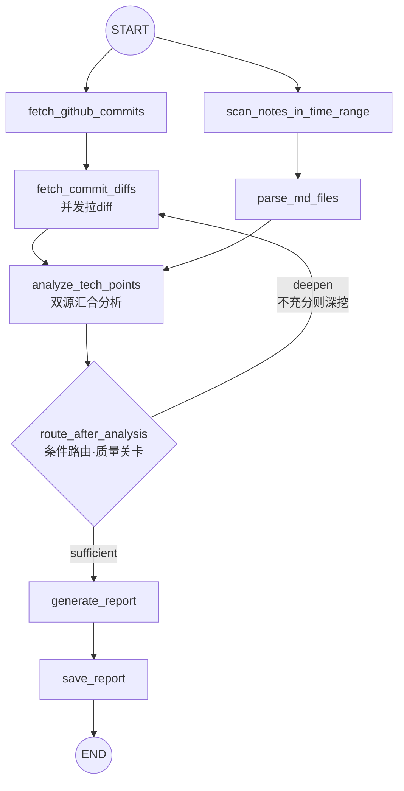

# 📊 月报 Agent（Monthly Report Agent）

> 自动拉取 **GitHub commit（含 diff）** + **本地 Obsidian 笔记**，用 LLM 生成结构化技术月报的 LangGraph 单智能体项目。

一条命令生成"本月我做了什么 + 学了什么"的结构化技术月报，数据来源双管齐下：
远程 GitHub 提交记录（含代码 diff 细节）与本地 Markdown 学习笔记。

---

## ✨ 项目亮点

| 亮点 | 说明 |
| -- | -- |
| 🧠 **LangGraph 图编排** | 两条并行链路（fan-out/fan-in）在分析节点汇合，支持条件路由与循环 |
| 🔁 **质量关卡 + 自动深挖** | 分析结果不充分时自动循环深挖一轮（补充低信息量 commit 的 diff + 放大截断窗口），有限轮数强制收口防死循环 |
| 💰 **全局 token 预算** | 笔记优先、commit 补充，边拼边累计——单条截断不够，显式预算兜底（成本/质量/可移植性平衡） |
| ⚡ **并发优化** | `fetch_commit_diffs` 有界线程池并发调 GitHub API：**42.3s → 秒级**，兼顾限流、顺序保真、单条失败隔离 |
| 🔒 **私有仓库兼容** | fine-grained token 授权即可读取私有仓库，无需修改仓库可见性 |
| 📈 **LangSmith 可观测** | 每个节点独立 trace，token 用量可视化 |

---

## 🏗️ 架构图



**图的关键能力**：普通边（顺序执行）+ 并行汇合（fan-out/fan-in）+ 条件边（`add_conditional_edges`）+ **循环**（不充分自动深挖，有终止保护）——覆盖 LangGraph 四大核心机制。

---

## 🧠 工作原理

### 数据流

```
链路1（远程）：GitHub API → 拉本月 commits → 并发拉 diff ─┐
                                                          ├─→ LLM 分析（笔记优先、commit 补充）
链路2（本地）：git ls-files + git log → 扫本月笔记 → 读全文 ─┘
                                                          │
                                    路由：充分 → 出报告；不充分 → 深挖循环（≤2轮）
```

### 迭代历程（每个 Phase 都是独立可讲的工程点）

| 阶段 | 内容 |
| -- | -- |
| **Phase 1** | GitHub commit 分析链路（含 diff 增强：黑名单过滤、merge 跳过、截断调参） |
| **Phase 2** | 本地笔记链路（`git log` 时间过滤、`core.quotepath` 中文文件名修复、全文解析） |
| **Phase 2.5** | 条件路由质量关卡（充分性判定 + 深挖循环 + 自洽性修正） |
| **Phase 2.6** | 全局 token 预算（笔记优先分配、边拼边累计） |
| **Phase 2.7** | diff 拉取并行化（有界线程池，42s → 秒级） |

---

## 🛠️ 技术栈

```
LangGraph        图编排（并行汇合 / 条件路由 / 循环）
LangSmith        可观测性（每节点 trace + token 统计）
langchain-openai LLM 调用（ChatOpenAI + DeepSeek base_url 兼容）
DeepSeek API     分析 / 报告生成（deepseek-v4-flash，1M 上下文）
requests         GitHub REST API
python-dotenv    环境变量管理
```

---

## 🚀 快速开始

### 环境要求

- Python 3.11+（建议独立 conda 环境）
- DeepSeek API Key（[platform.deepseek.com](https://platform.deepseek.com)）
- GitHub token（fine-grained PAT，需授权目标仓库 + `Contents: Read` 权限）

### 安装与配置

```bash
# 1. 克隆并创建环境
git clone https://github.com/WenEnguang/Report_Agent.git
cd Report_Agent
conda create -n langgraph python=3.11 -y
conda activate langgraph

# 2. 安装依赖
pip install langgraph langchain-openai requests python-dotenv

# 3. 配置环境变量（复制 .env.example 为 .env 并填写）
cp .env.example .env
```

**`.env` 配置模板**（`NOTES_DIR` 指向你的本地笔记 git 仓库）：

```ini
GITHUB_TOKEN=你的_fine_grained_token
NOTES_DIR=E:/Markdown

DEEPSEEK_API_KEY=你的_deepseek_key
DEEPSEEK_MODEL=deepseek-v4-flash
DEEPSEEK_URL=https://api.deepseek.com/v1

LANGCHAIN_TRACING_V2=true
LANGCHAIN_API_KEY=你的_langsmith_key
LANGCHAIN_PROJECT=monthly-report-agent
```

### 运行

```bash
python monthly_agent.py
```

### 输出

生成的月报写入 `docs/report_YYYY-MM-DD.md`，三段式结构：`已做任务 / 技术难点与解决方案 / 未来改进方向`。

---

## 📁 项目结构

```
monthly_agent.py            主程序：State Schema + 7 个节点 + 图编排 + CLI 入口
docs/
├── 项目规划.md             进度清单与续接上下文
├── 项目复盘归纳.md         踩坑复盘与面试速查（Phase 1~2.7）
├── GitHub数据流转说明.md    GitHub 链路数据流
├── Notes数据流转说明.md     笔记链路数据流
└── report_*.md             生成的月报样例
skills/
└── technical-monthly-report/ 可复用 Skill（工作流定义 / 提示词 / 示例输入）
test/
└── *.py                    链路拆分调试脚本
```

---

## 💡 关键设计决策（为什么这么做）

> 完整复盘见 `docs/项目复盘归纳.md`

1. **笔记过滤用 `git log` 而不是文件 mtime**——Obsidian 自动保存会污染 mtime，git 时间戳才代表真实内容产出
2. **文件列表用 `git ls-files` 而不是 `os.walk`**——路径与 commit 历史严格一致（避 Windows 大小写坑），且天然排除未跟踪文件
3. **`-c core.quotepath=false`**——否则中文文件名被八进制转义，文件静默丢失（不报错）
4. **单条截断不够，要全局 token 预算**——笔记/commit 数量不可控，显式预算兜底成本与质量
5. **I/O 密集用线程池，不用 Send/reducer**——GIL 不锁 I/O 等待；图级 fan-out 留给"每分支是子工作流"的场景
6. **循环三要素**——终止条件（有限轮数）、增量信息（深挖产出新输入）、有得可挖（空数据不空转）
7. **路由函数只读**——改 state 只能靠节点 return，图走向可预测、可调试

---

## 🗺️ Roadmap

- [ ] 笔记截断升级：分块（chunking）/ 先摘要再分析，替代简单截断
- [ ] `REPORT_PROMPT` 格式约束（当前 LLM 输出格式偶有漂移）
- [ ] 清理调试脚本，`.cursor/rules` 守护文件
- [ ] Phase 3：论文摘要（稳定运行满一个完整月报周期后评估）

---
## 🙋 关于作者

技术学习记录向个人项目，欢迎 Star ⭐ 与 Issue 交流。
