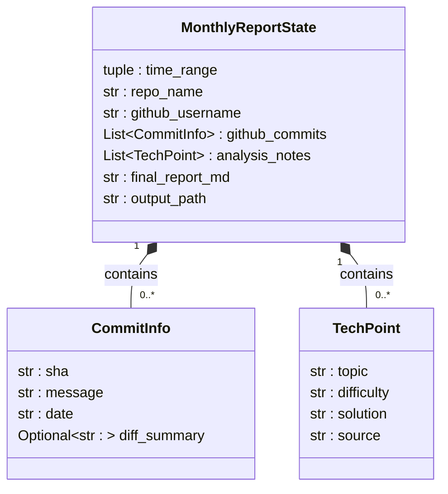

### Github数据流转说明
**核心机制**：LangGraph对State的更新是浅合并——节点函数return出去的dict， 只会覆盖dict里列出的那些key，其余字段维持上一步的值不变。



#### node 1:fetch_gitub_commits
|   | 内容 |
| -- | -- |
| 读取的内容 | state中的time_range, repo_name, github_username |
| 更新的内容 | state中的github_commits:从空列表跟镶滚成有数据的CommiInfo列表 |

#### node 2:fetch_commit_diffs
|  | 内容 |
| -- | -- |
| 读取的字段 | state中的github_commits(节点1写入的数据)，github_username,repo_name |
| 更新的字段 | github_commits：整体替换为新构造的列表（不mutate传入的旧列表），其中被判定"非低信息量"的那些条目，diff_summary从None变成了实际diff文本 |

#### node 3:analyze_tech_points
| | 内容 |
| -- | -- |
| 读取的字段 | state中的github_commits |
| 内部处理 | 1._format_commits_for_prompt把github_commits列表转换成一段拼好的文本commits_text——这只是函数内部的局部变量，不会写回State 2. 拼进ANALYSIS_PROMPT模板，调用model.invoke(prompt) 3. 处理response.content（区分str/list两种类型，见你自己加的isinstance判断） 4. 清理可能的```json代码块包裹 5. json.loads解析成Python对象 6. 构造TechPoint列表 |
| 更新的字段 | analysis_notes：从空列表变成LLM提炼出的技术难点列表 |

#### node 4:generate_report 
| | 内容 |
| -- | -- |
| 读取的字段 | state中的analysis_notes |
| 写回的字段 | final_report_md：从空字符串变成LLM生成的Markdown文本 |


