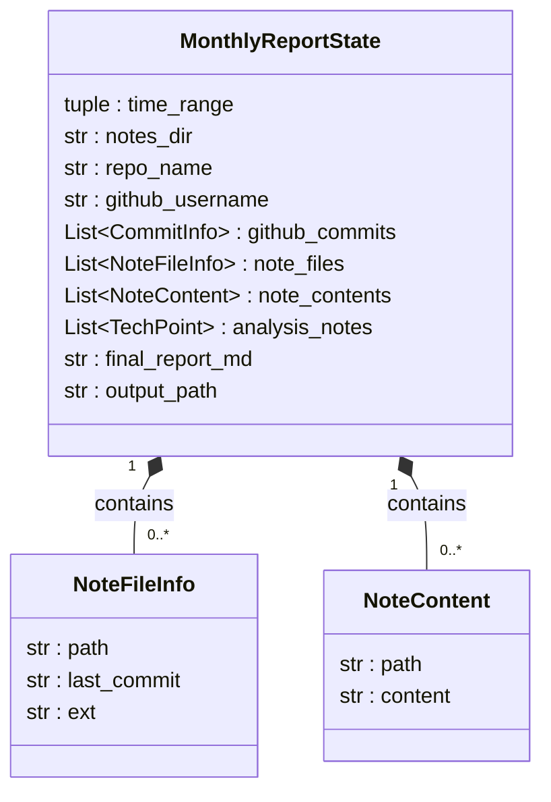

### Notes数据流转说明

**核心机制**：LangGraph对State的更新是浅合并——节点函数return出去的dict，只会覆盖dict里列出的那些key。

**与Github链路的关系**：Notes链路和Github链路是**两条并行分支**，都从 START 出发，最后在 `analyze_tech_points` 汇合（fan-out / fan-in）。LangGraph 的语义：一个节点只有等它所有上游边都完成后才会执行，所以 `analyze_tech_points` 一定是在笔记链路和 commit 链路都跑完之后才执行。



#### node 1:scan_notes_in_time_range（扫描）

|  | 内容 |
| -- | -- |
| 读取的字段 | state中的 `time_range`（过滤时间窗口）、`notes_dir`（笔记目录绝对路径） |
| 内部处理 | 1. `git -c core.quotepath=false ls-files -- *.md *.markdown *.txt` 拿所有被跟踪的笔记文件（注意：必须关 quotepath，否则中文文件名被八进制转义、后面匹配不到） 2. 对每个文件 `git log -1 --format=%ai -- <file>` 取最后commit时间 3. 截取前19字符转成 datetime，判断 `since <= date <= until`，落在范围内的才保留 |
| 更新的字段 | `note_files`：从空列表变成"本月内 commit 过"的笔记文件元数据列表（每个元素含 path / last_commit / ext） |

#### node 2:parse_md_files（解析）

|  | 内容 |
| -- | -- |
| 读取的字段 | state中的 `note_files`（节点1写入的元数据）、`notes_dir`（用于拼绝对路径） |
| 内部处理 | 遍历 note_files，`Path(notes_dir) / path` 拼成磁盘真实路径，`read_text(encoding="utf-8")` 读完整正文；单个文件读失败（OSError / UnicodeDecodeError）打印警告并跳过，不中断整条链路（fail-safe） |
| 更新的字段 | `note_contents`：从空列表变成"笔记正文"列表（每个元素含 path / content） |

#### 汇合节点:analyze_tech_points（笔记链路的终点）

|  | 内容 |
| -- | -- |
| 读取的字段 | state中的 `note_contents`（笔记正文）+ `github_commits`（commit记录），两条链路在此汇合 |
| 内部处理 | 1. 两个数据源都为空时直接 `return {"analysis_notes": []}` 短路（省一次LLM调用） 2. `_format_notes_for_prompt` 把 note_contents 拼成笔记文本（超过 MAX_CHARS_PER_NOTE 的截断） 3. `_format_commits_for_prompt` 拼 commit 文本 4. 两者一起填入 ANALYSIS_PROMPT（笔记优先、commit 补充） 5. model.invoke 6. 剥离可能的 ```json 包裹 7. json.loads 解析 8. 构造 TechPoint 列表 |
| 更新的字段 | `analysis_notes`：从空列表变成 LLM 提炼出的技术难点列表（笔记+commit 混合来源，source 标记为 "commit+note"） |

#### 数据流一图流

```
START
  ├─> scan_notes_in_time_range ─> parse_md_files ─┐
  │                                                ├─> analyze_tech_points ─> generate_report ─> save_report ─> END
  └─> fetch_github_commits ─> fetch_commit_diffs ─┘
        （Github链路，见 GitHub数据流转说明.md）
```
