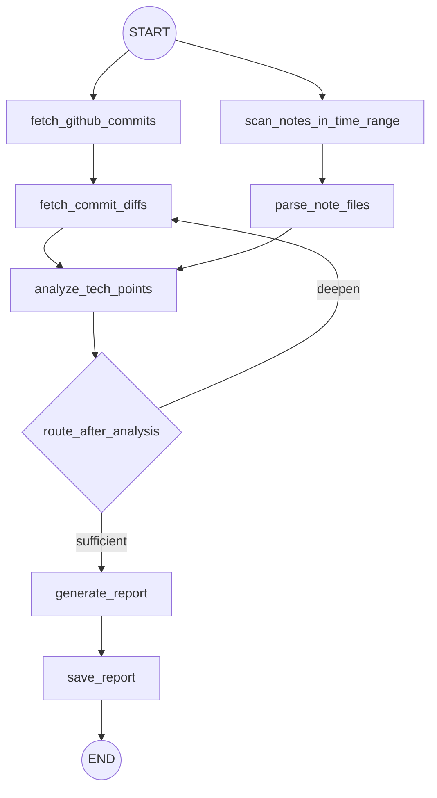

# 工作流参考（逻辑节点契约）

> 本文件描述的是**工作流逻辑节点**与 I/O 契约，不代表这些节点在本目录内已提供可执行 Python 实现。

## 1. 节点拓扑

## 2. 逻辑节点契约（Workflow Logic Node）

| 节点名 | 输入（关键字段） | 输出（关键字段） |
|---|---|---|
| `fetch_github_commits` | `time_range`、`github.repo`、`github.username` | `github_commits[]` |
| `fetch_commit_diffs` | `github_commits[]`、`github.include_diff` | `github_commits[]`（补充 diff）、`stats.deepen_rounds` |
| `scan_notes_in_time_range` | `notes.directory`、`time_range` | `note_files[]` |
| `parse_note_files` | `note_files[]`、`notes.directory` | `note_contents[]` |
| `analyze_tech_points` | `github_commits[]`、`note_contents[]` | `analysis_notes[]` |
| `route_after_analysis` | `analysis_notes[]`、`constraints.*`、`stats.deepen_rounds` | `sufficient` \| `deepen` |
| `generate_report` | `analysis_notes[]`、`time_range` | `report_markdown` |
| `save_report` | `report_markdown`、`output.output_path`、`output.write_file` | `output_path` |

## 3. 可执行实现说明（Executable Implementation）

- 本 skill 包当前不包含 Python 可执行实现文件。
- 若需要 Python/LangGraph 落地，请按 `SKILL.md` 与本文件契约自行实现。
- 如你已有实现（例如仓库根目录的历史脚本），应建立字段映射后再复用，避免把节点名误当现成 API。

## 4. 终止与循环条件

`route_after_analysis` 必须与 `SKILL.md` 一致：

1. 结果充分 -> `sufficient`
2. 达到 `max_fetch_rounds` -> `sufficient`
3. 无可深挖新增数据 -> `sufficient`
4. 否则 -> `deepen`

并保证循环有上限，不允许无界重试。
