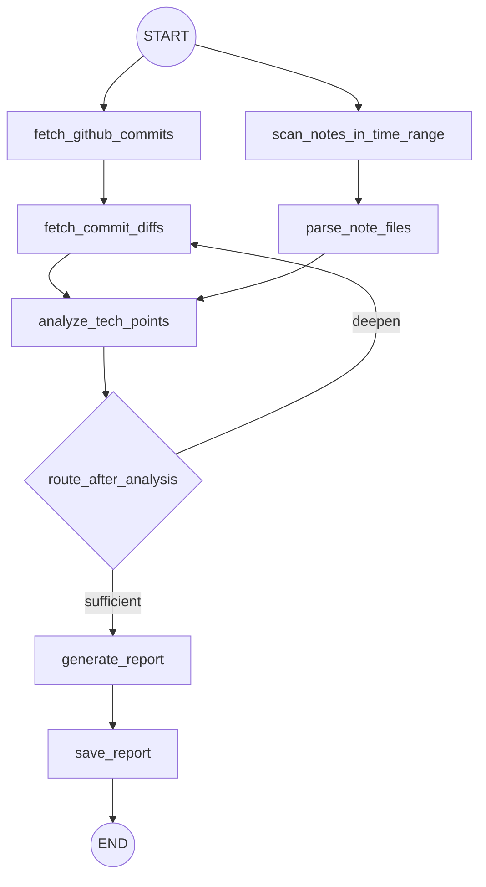

# 工作流参考

## 节点契约

| 节点 | 输入 | 输出 |
|---|---|---|
| `fetch_github_commits` | 时间范围、仓库、用户 | `github_commits` |
| `fetch_commit_diffs` | commits、仓库 | 补充 diff、深挖计数 |
| `scan_notes_in_time_range` | 笔记目录、时间范围 | `note_files` |
| `parse_note_files` | `note_files`、笔记目录 | `note_contents` |
| `analyze_tech_points` | commits、diff、笔记 | `analysis_notes` |
| `route_after_analysis` | 分析结果、深挖状态 | `sufficient` 或 `deepen` |
| `generate_report` | `analysis_notes` | `final_report_md` |
| `save_report` | 报告文本、输出路径 | 文件和 `output_path` |

## 终止条件

循环必须在以下任一条件满足时结束：

- 分析结果充分；
- 没有新的 commit 或其他数据可深挖；
- 达到最大深挖轮数；
- 外部数据源不可用且没有新增输入。
